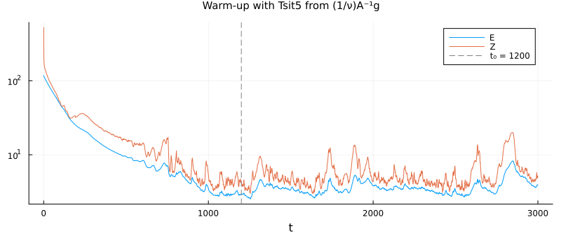
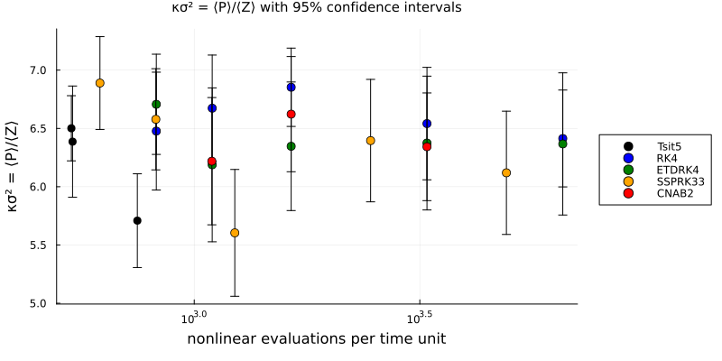
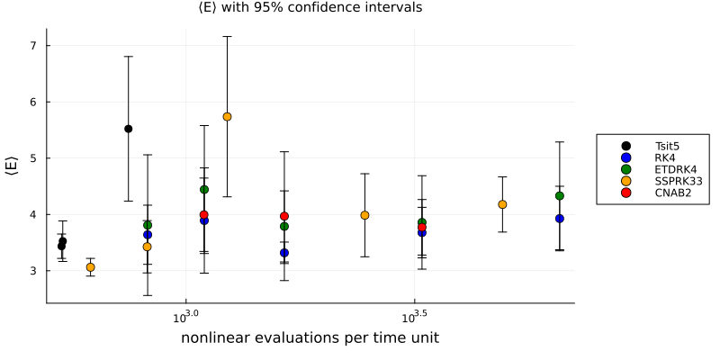
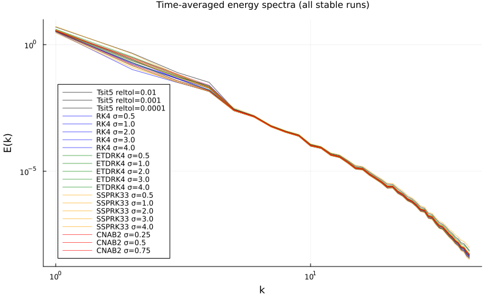

@def title = "Time stepping for chaotic flows"

# {{ get_title }}

The comparisons in [Stiff solvers, Jacobians and automatic differentiation](/pages/literated/stiff_solvers_report) were made at a large viscosity, $\nu = 1$, where the flow converges to a steady state and the time step is limited by the viscous term. Here we look at the opposite regime: a small viscosity and a multi-mode forcing, which sustain a chaotic flow, where advection is the dominant term. We compare explicit, exponential and implicit-explicit (IMEX) methods by the cost of computing the *statistics* of the flow.

The results come from a single experiment, run once on a 4-core Linux machine, and are reported as static tables and figures; nothing is executed when this page is built. The scripts that reproduce them are in the folder [`benchmarks/turbulence/`](https://github.com/rmsrosa/2dnsepervortjl/tree/main/benchmarks/turbulence) of the repository.

## Which term limits the time step?

In spectral space, the viscous term $\nu\Delta\omega$ is diagonal, with real eigenvalues down to $-\nu k_{\max}^2$, while the advection term has nearly imaginary eigenvalues of size up to about $k_{\max}(|u|_{\max} + |v|_{\max})$, where $k_{\max}$ is the largest retained wavenumber. For an explicit or exponential scheme, the step is limited by whichever of the two rates

$$
\nu k_{\max}^2 \qquad \text{and} \qquad k_{\max}\left(|u|_{\max} + |v|_{\max}\right)
$$

is larger. For the setup of the earlier pages ($N = 128$, `Nsub = 84`, so $k_{\max} = 41$, the same initial condition and single-mode forcing), the ratio between the viscous and the advective rates is:

| $\nu$ | $t = 0$ | $t = 1$ | $t = 10$ |
| :--- | ---: | ---: | ---: |
| 1 | 0.67 | **180** | **180** |
| 0.1 | 0.067 | 0.66 | 1.5 |
| 0.01 | 0.0067 | 0.007 | 0.011 |

So, for $\nu = 1$, after a short transient, the problem is stiff because of the viscous term, and implicit and exponential methods pay off. For small $\nu$, advection is about a hundred times faster than viscous decay, the problem is not stiff, and the step is limited by a CFL-type condition

$$
\Delta t \lesssim \frac{c}{k_{\max}\left(|u|_{\max} + |v|_{\max}\right)},
$$

where $c$ is the extent of the stability region of the method along the imaginary axis ($c = 2\sqrt{2} \approx 2.8$ for the classical fourth-order Runge-Kutta method, $\sqrt{3} \approx 1.7$ for the three-stage strong-stability-preserving method `SSPRK33`).

Consequences, to be checked by the experiment below:

* ETDRK4 integrates $\nu\Delta$ exactly, but this no longer helps much: as $\nu \to 0$, ETDRK4 reduces to the classical RK4 method, with the same stability limit along the imaginary axis.
* Implicit methods are not suitable. Steps beyond the CFL limit do not resolve the advection of the small scales, and implicit methods then damp them or shift their phase, which biases exactly the small-scale statistics; the Jacobian is dominated by advection, so the linear solves need many iterations; and BDF methods of order three and higher are not stable near the imaginary axis.
* For a chaotic flow, what matters is not the error along trajectories, which grows exponentially anyway, but the bias in the long-time statistics, a kind of weak convergence, as for stochastic differential equations. With a fourth-order method at the stability limit, this bias is expected to be much smaller than the sampling error of the time averages, so the cost is set by stability rather than by accuracy.

## The experiment

* **Equation and discretization:** the vorticity equation in spectral form, with $N = 128$, dealiasing with `Nsub = 84` ($k_{\max} = 41$), and viscosity $\nu = 4 \times 10^{-3}$.
* **Forcing:** steady, on all 20 modes with $2 \leq |\mathbf{k}| \leq 4$, with equal amplitudes and random phases, scaled so that the curl of the forcing has root-mean-square value 1.
* **Initial condition and warm-up:** the field $\omega = (1/\nu)A^{-1}g$ in vorticity form, i.e. the solution of the Stokes problem, which is not a steady state of the full equation for this forcing, integrated with `Tsit5()` (default tolerances) up to $t = 3000$.
* **Runs:** each method starts from the state at $t_0 = 1200$, including a restart of `Tsit5()`, and runs for 1000 time units.
* **Diagnostics,** sampled every 0.5 time units (spatial means): the energy $E = \tfrac12\langle|\mathbf{u}|^2\rangle$, the enstrophy $Z = \tfrac12\langle|\nabla\mathbf{u}|^2\rangle = \tfrac12\langle\omega^2\rangle$, the palinstrophy $P = \tfrac12\langle|\Delta\mathbf{u}|^2\rangle = \tfrac12\langle|\nabla\omega|^2\rangle$, the shell-averaged energy spectrum, and

$$
\kappa_\sigma^2 = \frac{\langle\|\Delta\mathbf{u}\|_{L^2}^2\rangle}{\langle\|\nabla\mathbf{u}\|_{L^2}^2\rangle} = \frac{\langle P\rangle}{\langle Z\rangle},
$$

  a Taylor-like wavenumber (squared) for the dissipation of enstrophy.
* **Confidence intervals:** 95% intervals from 10 batch means of 100 time units each, since the large-scale fluctuations are correlated over long times.
* **Step size:** for the fixed-step methods, $\Delta t = \sigma/(k_{\max}U_*)$, with $U_* = 20$, slightly above the largest $|u|_{\max} + |v|_{\max}$ seen during the warm-up. The *typical* and *maximum* CFL numbers, $\Delta t\, k_{\max}(|u|_{\max} + |v|_{\max})$, were measured during each run.
* **Methods:** `Tsit5()` (adaptive, `reltol` from $10^{-2}$ to $10^{-4}$, `abstol = 1e-3 * reltol`), `RK4()`, `ETDRK4()`, `SSPRK33()`, and CNAB2 (Crank-Nicolson for $\nu\Delta$, second-order Adams-Bashforth for the rest).

### The warm-up

Starting from $(1/\nu)A^{-1}g$, which has a lot of energy, the flow takes about 1000 time units, several times the viscous time scale $1/(2\nu) = 125$ of the largest scales, to reach a statistically steady regime. In that regime, most of the energy (85% to 97%) is in the $|\mathbf{k}| = 1$ modes, a condensate fed by the inverse energy cascade, with intermittent bursts in which the condensate loses part of its energy to the smaller scales.

This regime is chaotic but not turbulent: $\kappa_\sigma \approx 2.5$ lies inside the forcing band, so there is no range of scales between forcing and dissipation, and the spectrum is steep, with no enstrophy-cascade range. The flow is nonetheless irregular and sensitive to small perturbations: runs of different methods started from the same state, whose energies first differ by less than $10^{-6}$, differ by 1% after about 70 to 110 time units and by 10% after about 90 to 140 time units. Small differences thus grow at a rate of roughly 0.2 to 0.3 per time unit, a rough estimate of the leading Lyapunov exponent. The spectrum is very well resolved, decaying by about eight orders of magnitude up to $k_{\max}$.

## Results

| Method | Parameter | $\Delta t$ | Typical CFL | Max CFL | Stable | $\langle E\rangle$ | $\langle Z\rangle$ | $\langle P\rangle$ | $\kappa_\sigma^2$ | Nonlinear evaluations per time unit |
| :--- | ---: | ---: | ---: | ---: | :---: | ---: | ---: | ---: | ---: | ---: |
| Tsit5 | reltol = 0.01 | – | – | – | yes | 3.53 ± 0.36 | 5.41 ± 1.07 | 34.3 ± 6.5 | 6.39 ± 0.48 | 537 |
| Tsit5 | reltol = 0.001 | – | – | – | yes | 5.52 ± 1.28 | 9.66 ± 3.30 | 54.6 ± 19.0 | 5.71 ± 0.40 | 748 |
| Tsit5 | reltol = 0.0001 | – | – | – | yes | 3.44 ± 0.22 | 5.01 ± 0.57 | 32.5 ± 3.4 | 6.50 ± 0.28 | 534 |
| RK4 | σ = 0.5 | 0.00061 | 0.20 | 0.42 | yes | 3.93 ± 0.57 | 6.17 ± 1.37 | 39.2 ± 8.1 | 6.41 ± 0.42 | 6560 |
| RK4 | σ = 1 | 0.00122 | 0.38 | 0.80 | yes | 3.68 ± 0.45 | 5.53 ± 1.18 | 36.0 ± 7.2 | 6.54 ± 0.48 | 3280 |
| RK4 | σ = 2 | 0.00244 | 0.70 | 1.28 | yes | 3.32 ± 0.19 | 4.64 ± 0.47 | 31.7 ± 2.4 | 6.85 ± 0.34 | 1640 |
| RK4 | σ = 3 | 0.00365 | 1.13 | 2.40 | yes | 3.89 ± 0.94 | 6.35 ± 2.34 | 41.4 ± 13.2 | 6.67 ± 0.46 | 1096 |
| RK4 | σ = 4 | 0.00485 | 1.50 | 3.54 | yes | 3.64 ± 0.53 | 5.61 ± 1.23 | 35.9 ± 6.9 | 6.48 ± 0.51 | 824 |
| RK4 | σ = 6 | 0.00725 | 2.36 | 5.24 | blew up at t = 1409 | – | – | – | – | 552 |
| RK4 | σ = 8 | 0.00962 | 2.68 | 4.74 | blew up at t = 1363 | – | – | – | – | 416 |
| ETDRK4 | σ = 0.5 | 0.00061 | 0.22 | 0.44 | yes | 4.33 ± 0.96 | 6.92 ± 2.17 | 42.8 ± 11.2 | 6.37 ± 0.61 | 6560 |
| ETDRK4 | σ = 1 | 0.00122 | 0.38 | 1.01 | yes | 3.86 ± 0.83 | 6.14 ± 2.60 | 38.6 ± 15.7 | 6.38 ± 0.57 | 3280 |
| ETDRK4 | σ = 2 | 0.00244 | 0.75 | 1.63 | yes | 3.79 ± 0.63 | 5.78 ± 1.47 | 36.4 ± 9.5 | 6.35 ± 0.55 | 1640 |
| ETDRK4 | σ = 3 | 0.00365 | 1.21 | 3.03 | yes | 4.44 ± 1.14 | 7.45 ± 2.72 | 44.2 ± 14.1 | 6.19 ± 0.66 | 1096 |
| ETDRK4 | σ = 4 | 0.00485 | 1.47 | 4.12 | yes | 3.81 ± 1.25 | 6.61 ± 3.42 | 42.7 ± 19.1 | 6.71 ± 0.43 | 824 |
| ETDRK4 | σ = 6 | 0.00725 | 2.61 | 5.15 | blew up at t = 1683 | – | – | – | – | 552 |
| ETDRK4 | σ = 8 | 0.00962 | 2.74 | 5.22 | blew up at t = 1364 | – | – | – | – | 416 |
| SSPRK33 | σ = 0.5 | 0.00061 | 0.22 | 0.40 | yes | 4.18 ± 0.49 | 6.70 ± 1.35 | 40.5 ± 7.3 | 6.12 ± 0.53 | 4920 |
| SSPRK33 | σ = 1 | 0.00122 | 0.37 | 0.91 | yes | 3.99 ± 0.74 | 6.22 ± 1.79 | 38.7 ± 9.1 | 6.40 ± 0.53 | 2460 |
| SSPRK33 | σ = 2 | 0.00244 | 1.07 | 2.07 | yes | 5.74 ± 1.42 | 9.51 ± 3.07 | 52.0 ± 15.5 | 5.60 ± 0.54 | 1230 |
| SSPRK33 | σ = 3 | 0.00365 | 1.05 | 2.16 | yes | 3.43 ± 0.47 | 5.00 ± 0.98 | 32.4 ± 4.7 | 6.58 ± 0.43 | 822 |
| SSPRK33 | σ = 4 | 0.00485 | 1.38 | 2.70 | yes | 3.06 ± 0.16 | 4.47 ± 0.36 | 30.7 ± 2.8 | 6.89 ± 0.40 | 618 |
| SSPRK33 | σ = 6 | 0.00725 | 2.01 | 3.55 | blew up at t = 1302 | – | – | – | – | 414 |
| CNAB2 | σ = 0.25 | 0.00031 | 0.09 | 0.21 | yes | 3.77 ± 0.49 | 5.48 ± 1.04 | 34.7 ± 7.2 | 6.34 ± 0.46 | 3280 |
| CNAB2 | σ = 0.5 | 0.00061 | 0.19 | 0.49 | yes | 3.97 ± 1.15 | 6.79 ± 3.01 | 43.6 ± 17.1 | 6.62 ± 0.49 | 1640 |
| CNAB2 | σ = 0.75 | 0.00091 | 0.30 | 0.64 | yes | 4.00 ± 0.65 | 6.53 ± 1.97 | 40.6 ± 13.2 | 6.22 ± 0.55 | 1094 |
| CNAB2 | σ = 1 | 0.00122 | 0.35 | 0.89 | blew up at t = 1546 | – | – | – | – | 820 |
| CNAB2 | σ = 2 | 0.00244 | 0.68 | 1.00 | blew up at t = 1352 | – | – | – | – | 410 |

"Stable" means that the run lasted the full 1000 time units; the runs that blew up did so during a burst.

### Statistics

The intervals of $\langle E\rangle$, $\langle Z\rangle$ and $\langle P\rangle$ are wide, about 5% to 50%, because of the slow, intermittent dynamics of the condensate. The ratio $\kappa_\sigma^2 = \langle P\rangle/\langle Z\rangle$ is much more robust, with intervals of about 4% to 11%, and most runs give $\kappa_\sigma^2 \approx 6.2$ to $6.9$, i.e. $\kappa_\sigma \approx 2.5$.

The stable runs agree within their 95% confidence intervals, with two exceptions: `Tsit5` with `reltol = 1e-3` and `SSPRK33` with $\sigma = 2$, whose trajectories had more bursts, give higher $\langle E\rangle$, $\langle Z\rangle$ and $\langle P\rangle$ and a lower $\kappa_\sigma^2 \approx 5.6$ to $5.7$, which does not overlap with the interval of, say, RK4 with $\sigma = 2$. These deviations are not related to the step size or tolerance, since the neighbouring parameters of the same methods agree with the other runs; they indicate that the confidence intervals from 10 batches underestimate the uncertainty, because the bursts are correlated over times comparable to the batch length.

The time-averaged spectra coincide at all but the largest scales, $k \leq 4$, where the fluctuations of the condensate dominate:

No systematic bias due to the time discretization can be detected: over a factor of 8 in the time step for RK4 and ETDRK4, and over the whole range of tolerances for `Tsit5`, the differences show no trend with the step size and are of the size of the sampling fluctuations. Detecting a smaller bias would require much longer runs. The runs all start from the same state, so their first part is correlated; they then diverge, since the flow is chaotic, within about 100 time units (see the warm-up section), a tenth of the length of each run.

### Stability limits

| Method | Largest σ stable for 1000 time units | Blew up at | Max CFL observed in the largest stable run |
| :--- | ---: | ---: | ---: |
| RK4 | 4 | σ = 6 | 3.5 |
| ETDRK4 | 4 | σ = 6 | 4.1 |
| SSPRK33 | 4 | σ = 6 | 2.7 |
| CNAB2 | 0.75 | σ = 1 | 0.64 |

* RK4 and ETDRK4 have the same stability limit: the viscous term plays no role here.
* SSPRK33 is stable up to the same step as RK4 in this test, even though its theoretical limit along the imaginary axis is smaller; but its largest stable run happened to have weaker bursts (maximum CFL of 2.7 rather than 3.5), so its margin is smaller.
* CNAB2 needs a step about five to six times smaller: the Adams-Bashforth part has no stability along the imaginary axis, and only the viscous damping stabilizes it.
* Being stable for 1000 time units does not guarantee stability over longer runs, since a stronger burst may come later.

### Cost

The cost of one step, measured on its own (single-threaded, with no other process competing), and the resulting cost per time unit:

| Method | Cost per step (ms) | Steps per time unit | Cost per time unit (s) |
| :--- | ---: | ---: | ---: |
| one evaluation of the nonlinear term | 0.144 | | |
| Tsit5, reltol = 0.01 or 0.0001 | 1.50 | 89 | 0.13 |
| Tsit5, reltol = 0.001 | 1.50 | 125 | 0.19 |
| SSPRK33, σ = 4 | 0.58 | 206 | 0.12 |
| SSPRK33, σ = 3 | 0.58 | 274 | 0.16 |
| RK4, σ = 4 | 0.82 | 206 | 0.17 |
| RK4, σ = 3 | 0.82 | 274 | 0.23 |
| ETDRK4, σ = 4 | 1.13 | 206 | 0.23 |
| ETDRK4, σ = 3 | 1.13 | 274 | 0.31 |
| CNAB2 (hand-written), σ = 0.75 | 0.22 | 1094 | 0.24 |
| CNAB2 (hand-written), σ = 0.5 | 0.22 | 1640 | 0.36 |

* `Tsit5` takes the same number of steps at `reltol = 1e-2` as at `1e-4`: its step is limited by stability, not by the tolerance, and it adapts to the instantaneous velocity, with typical CFL numbers of 3 to 4, while a fixed step must be chosen for the bursts. (The run with `reltol = 1e-3` took more steps because its trajectory had stronger bursts.)
* In OrdinaryDiffEq, one ETDRK4 step costs about 40% more than one RK4 step, with no gain in stability here.
* CNAB2 is the cheapest per step, with a single evaluation of the nonlinear term, but needs so many more steps that it ends up 1.5 to 3 times more expensive than the explicit methods.

## Recommendation

For chaotic, advection-dominated flows like this one, and, we expect, for turbulent flows as well:

* **An adaptive explicit method, such as `Tsit5()` with a loose tolerance (e.g. `reltol = 1e-2`), is the simplest choice and among the cheapest.** It needs no choice of time step, follows the bursts automatically, and its statistics are consistent with those of the other methods, within the sampling fluctuations.
* **A fixed-step explicit Runge-Kutta method (`SSPRK33()` or `RK4()`) is equally good** if a fixed step is preferred, for instance to sample at regular times. With $\Delta t = \sigma/(k_{\max}U_*)$, $U_*$ the largest $|u|_{\max} + |v|_{\max}$ seen during a long warm-up, $\sigma \approx 2$ to 3 leaves a margin of about two below the observed blow-up at $\sigma = 6$.
* **ETDRK4 brings no benefit in this regime** and costs more per step. It is the right choice when the viscous term is stiff: large viscosity, as in the earlier pages, higher resolution relative to the dissipation scale, or hyperviscosity.
* **CNAB2 works, but requires a much smaller step** and ends up more expensive.
* **Implicit methods are not recommended** for this regime.

### Choosing the step for ETDRK4

ETDRK4 in OrdinaryDiffEq uses a fixed step, and it cannot change the step during a run: it caches the exponential coefficients for that step and throws an error if the step changes, even by round-off, so the step cannot be adapted to the CFL number on the fly. The step must therefore be chosen in advance:

1. Run a long warm-up (with `Tsit5()`, for instance) until the statistics settle, and record $|u|_{\max} + |v|_{\max}$; take $U_*$ slightly above its maximum, since the bursts set the limit.
2. Take $\Delta t = \sigma/(k_{\max}U_*)$ with $\sigma \approx 2$ to 3 (here, stability was lost at $\sigma = 6$).
3. Check the statistics against a run with $\Delta t/2$, comparing the confidence intervals of $\langle E\rangle$, $\langle Z\rangle$, $\kappa_\sigma^2$ and the spectrum.
4. Monitor the CFL number during the run, e.g. with a callback, to detect an unexpectedly strong burst.

## Implementation notes

* **CNAB2 in OrdinaryDiffEq** must be given `linsolve = DiagonalFactorization()` (from LinearSolve) for a `SplitODEProblem` with a `DiagonalOperator`: with the default linear solver, it builds and factorizes a dense matrix at every step, about 1000 times slower. Even then, it costs about four times more per step than a hand-written CNAB2, which needs only one evaluation of the nonlinear term per step; the two give the same solution (relative difference $1.4 \times 10^{-10}$ after 2000 steps). The CNAB2 runs above use the hand-written version.
* **Fixed-step methods and sampling:** with `step!`, landing exactly on the sampling times may shorten the last step, which ETDRK4 does not allow; the scripts take a fixed number of steps between samples instead.

## Caveats

* A single set of parameters ($N = 128$, $\nu = 4\times10^{-3}$, one forcing) in a chaotic but not turbulent, condensate-dominated regime. For turbulent flows, which require a smaller viscosity resolved with a larger $N$, the viscous term becomes even less stiff relative to advection, which should strengthen the conclusions above (this was not tested); with hyperviscosity, on the other hand, the viscous term may become stiff again.
* The averaging windows of 1000 time units only resolve differences in the statistics larger than the sampling error, about 5% to 50% for $\langle E\rangle$, $\langle Z\rangle$ and $\langle P\rangle$, and about 4% to 11% for $\kappa_\sigma^2$, and these confidence intervals are probably underestimated, as discussed above.
* The costs depend on the implementation (OrdinaryDiffEq v7.8.1, FFTW, single-threaded runs at $N = 128$).

## Reproducing the results

From the folder `benchmarks/turbulence/` of the repository, `bash run_all.sh` runs the warm-up, all the methods, the timings and the analysis, writing the tables and figures to `figs/`. It takes about 1.5 hours on 4 cores.
